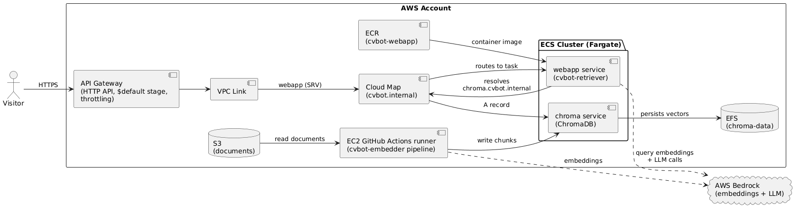

# cvbot-infra

Terraform infrastructure of the CVBot RAG system on AWS.

## Overview

CVBot is a personal RAG chatbot that answers questions about its owner's CV. This repository provisions everything it runs on in AWS: a private ChromaDB vector store and the web app on ECS Fargate, a public API Gateway in front, a self-hosted GitHub Actions runner for the ingestion pipeline, and the supporting IAM, networking and storage.

**Tools:** Terraform, AWS.

| Repository | Role |
| --- | --- |
| **cvbot-core** | Shared Python library used by embedder and retriever. |
| **cvbot-embedder** | Ingestion pipeline; runs on the EC2 runner created here and writes to ChromaDB. |
| **cvbot-retriever** | Web app image and its deploy/lifecycle workflows; runs on the ECS service created here. |
| **cvbot-infra** | This repository. |

## Components

| Component | Purpose |
| --- | --- |
| API Gateway | HTTP API on the `$default` stage; provides HTTPS without a domain and throttles requests to cap Bedrock cost. |
| VPC Link | Connects API Gateway to the private web app task. |
| Cloud Map (`cvbot.internal`) | Private DNS that gives the changing Fargate task IPs stable names (`webapp` as SRV, `chroma` as A record). |
| ECS cluster (Fargate) | Runs the two services without managing servers. |
| webapp service | Runs the cvbot-retriever container; answers questions using ChromaDB and Bedrock. |
| chroma service | Runs ChromaDB; holds the document vectors and is reachable only inside the VPC. |
| ECR (`cvbot-webapp`) | Stores the web app images; keeps only the most recent ones. |
| EFS (`chroma-data`) | Persists the ChromaDB data across task restarts. |
| S3 (documents) | Holds the source Markdown documents for ingestion. |
| EC2 GitHub Actions runner | Ephemeral self-hosted runner that executes the embedder pipeline inside the VPC. |
| AWS Bedrock | Not managed here; provides embeddings and the LLM. IAM only grants access. |

Not shown in the diagram: S3 bucket for the Terraform state, GitHub OIDC provider with the deploy role, SSM parameter for the runner PAT, security groups and CloudWatch log groups.

## Design decisions

The system is a proof of concept and a showcase: it does not need to be production ready or permanently online, should balance own code against managed services, and should be as cheap as possible. That leads to several deviations from a typical RAG deployment:

| Typical RAG setup | Here | Reason |
| --- | --- | --- |
| Managed vector database or search cluster | ChromaDB on Fargate with EFS | The corpus is a few dozen chunks; a managed service would cost more than the rest of the system. |
| Always-on services | Both services idle at `desired_count = 0`, started on demand by workflows | No compute cost between demos. Terraform ignores `desired_count`. |
| Load balancer | API Gateway HTTP API with VPC Link and Cloud Map | No hourly fee while stopped, built-in HTTPS, no domain or certificate to manage. |
| Private subnets with NAT gateway | Default VPC, public IPs, inbound closed by security groups | A NAT gateway would dominate the monthly cost. |
| Ingestion as a permanent service or managed job | Ephemeral self-hosted GitHub runner on EC2, started only for the pipeline | Reaches private ChromaDB and S3 without extra networking; pays only while running. |
| Database or cache for conversations | In-memory store in the single web app task | Nothing to operate or back up; conversations are not persisted by design. |
| Self-hosted models or framework-heavy stack | Bedrock models; own code only for chunking, metadata filtering and re-ranking | Managed models, own logic where it differentiates the system. |
| Static cloud credentials in deploy workflows | GitHub OIDC with a least-privilege deploy role | No long-lived keys outside the initial Terraform run. |

## Limitations

- No automatic scaling: exactly one task per service, which the in-memory conversation store requires.
- No high availability: single ChromaDB instance, single task, EFS holds the only copy of the vectors.
- Deployments replace the task, causing a short outage and losing running conversations.
- Services must be started manually and need a minute to become healthy.
- Throttling is global at the gateway; per-client limits live in the app and trust `X-Forwarded-For`.
- Tasks run in public subnets and are protected by security groups only; no WAF, no authentication, no custom domain.
- The deploy role trusts only repositories of the owner named `cvbot-*`.
- Apply runs automatically on every push to `main` without a plan review.

## Prerequisites

- An AWS account with an IAM user and access keys that may create the resources of this repository (S3, EC2, ECS, ECR, EFS, IAM, API Gateway, Cloud Map, CloudWatch Logs, SSM, VPC networking).
- A default VPC with default subnets in the target region.
- Bedrock model access in the target region for Titan Text Embeddings V2 and Claude Haiku 4.5 (via the `eu.*` inference profile).
- GitHub repositories `cvbot-infra`, `cvbot-embedder`, `cvbot-retriever` and `cvbot-core` under the same owner. The runner registers on the embedder repository.
- A fine-grained GitHub PAT for the runner registration and a GitHub App for pushing the rendered diagrams (see Setup).

## Setup

### GitHub configuration

1. **AWS credentials:** create an IAM access key for the Terraform user and store it as repository secrets **`AWS_ACCESS_KEY_ID`** and **`AWS_SECRET_ACCESS_KEY`**.
2. **Runner PAT:** create a fine-grained PAT for the embedder repository with the **Administration: Read and write** permission and store it as secret **`GH_PAT`**. Terraform saves it as an SSM `SecureString`; the runner uses it to register itself.
3. **Diagram push:** register a GitHub App with **Contents: Read and write**, install it on this repository and store its credentials as secrets **`APP_ID`** and **`APP_PRIVATE_KEY`** (same approach as in cvbot-core). The `render-diagrams` job uses it to commit `docs/*.png`.
4. **Variables:** set repository variables **`AWS_REGION`** (e.g. `eu-central-1`) and **`GH_REPO`** (name of the embedder repository). Further variables are optional overrides, see below.

### Bootstrap (first run)

The state bucket is itself managed by this Terraform project, so the first run has to work without remote state. The workflow handles this automatically:

1. It computes the bucket name `cvbot-terraform-state-<account-id>` and checks whether it exists.
2. If not, it initializes with a temporary local backend and applies only the state bucket resources.
3. It runs `terraform init -migrate-state` against the S3 backend, copying the local state into the bucket.
4. It applies the full configuration.

Later runs skip steps 1 to 3 and only initialize against S3 (with a lock file) and apply.

After the first apply:

1. Copy the created resource names and IDs (cluster, services, runner instance ID, documents bucket, deploy role ARN, API Gateway URL) into the repository variables of cvbot-embedder and cvbot-retriever; this repository defines no Terraform outputs.
2. Upload the Markdown documents to the documents bucket.
3. Run the embedder pipeline, to embed the documents.
4. Run the deploy workflow of cvbot-retriever to push the first image, then start the services via the lifecycle workflow.

## Environment variables

Set as GitHub repository **variables** unless marked as secret. All optional variables fall back to the Terraform default shown. The variable names in upper case map to the Terraform variable of the same name in lower case (`WEBAPP_TOP_K` to `webapp_top_k`).

Legend: **required** must be set; **shared** must be identical in other repositories.

### Required

| Name | Purpose | Shared |
| --- | --- | --- |
| `AWS_REGION` **required** | Region the infrastructure is deployed to. | **shared** with cvbot-embedder and cvbot-retriever |
| `GH_REPO` **required** | Name of the repository the runner registers on (the embedder repository). | **shared**: must equal the name of cvbot-embedder |
| `AWS_ACCESS_KEY_ID` (secret) **required** | Access key of the Terraform user. | |
| `AWS_SECRET_ACCESS_KEY` (secret) **required** | Secret key of the Terraform user. | |
| `GH_PAT` (secret) **required** | PAT used by the runner to self-register. | |
| `APP_ID` (secret) **required** | GitHub App ID for pushing rendered diagrams. | |
| `APP_PRIVATE_KEY` (secret) **required** | Private key of that GitHub App. | |

### Optional

| Name | Default | Purpose | Shared |
| --- | --- | --- | --- |
| `CHROMA_COLLECTION` | `cvbot_documents` | ChromaDB collection the web app queries. | **shared**: must equal the embedder's `CHROMA_COLLECTION` |
| `LLM_MODEL_ID` | `eu.anthropic.claude-haiku-4-5-20251001-v1:0` | Bedrock model (inference profile) that answers questions. | |
| `WEBAPP_PORT` | `8080` | Port of the web app container. | |
| `WEBAPP_IMAGE_TAG` | `latest` | Image tag pulled from ECR. | |
| `WEBAPP_TASK_CPU` | `256` | Fargate CPU units of the web app. | |
| `WEBAPP_TASK_MEMORY` | `512` | Fargate memory (MiB) of the web app. | |
| `ECR_IMAGE_RETENTION_COUNT` | `3` | Number of images kept in ECR. | |
| `WEBAPP_THROTTLE_RATE_LIMIT` | `5` | Requests per second accepted by API Gateway. | |
| `WEBAPP_THROTTLE_BURST_LIMIT` | `10` | Burst capacity of the API Gateway throttling. | |
| `WEBAPP_TOP_K` | `4` | Chunks passed to the LLM per question. | |
| `WEBAPP_OVERFETCH_FACTOR` | `4` | Multiplier of `top_k` fetched before re-ranking. | |
| `WEBAPP_FILTER_WEIGHT` | `0.2` | Maximum ranking bonus for matching metadata filters. | |
| `WEBAPP_RECENCY_WEIGHT` | `0.2` | Maximum ranking bonus for recent content; `0` disables it. | |
| `WEBAPP_RECENCY_WINDOW_YEARS` | `10` | Years over which the recency bonus decays to zero. | |
| `WEBAPP_MAX_CONTEXT_TOKENS` | `32000` | Upper bound of the context sent to the LLM. | |
| `WEBAPP_RESPONSE_TOKEN_BUFFER` | `2048` | Part of the context budget reserved for the answer. | |
| `WEBAPP_LOG_LEVEL` | `INFO` | Log level of the web app. | |
| `WEBAPP_RATE_LIMIT_PER_MINUTE` | `10` | Questions per client and minute. | |
| `WEBAPP_RATE_LIMIT_PER_HOUR` | `60` | Questions per client and hour. | |
| `WEBAPP_TRUST_FORWARDED_FOR` | `true` | Read the client address from `X-Forwarded-For` (needed behind API Gateway). | |
| `WEBAPP_CONVERSATION_TTL_SECONDS` | `1800` | Idle time after which a conversation is dropped. | |
| `WEBAPP_MAX_CONVERSATIONS` | `50` | Maximum number of conversations kept in memory. | |

Notes:

- The resource prefix `cvbot` is fixed in the workflow. The names in the cvbot-retriever variables (`cvbot-cluster`, `cvbot-webapp`, `cvbot-gha-deploy-role`, ...) derive from it and must match.
- Changing a `WEBAPP_*` runtime value updates the task definition only; the running service picks it up on the next deployment from cvbot-retriever.
